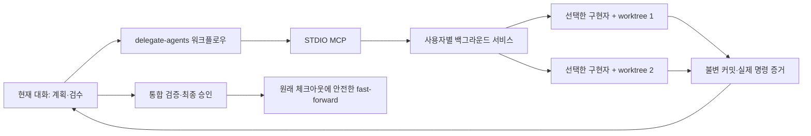

# Agent Delegation — 다중 플랫폼 위임 플러그인

현재 대화의 에이전트가 계획·작업 배분·검수·최종 보고를 맡고, 선택한 구현자가 격리된 Git worktree에서 코드를 작성하는 로컬 도구입니다. Codex·OpenCode·Claude Code·Kilo를 양쪽 역할에 사용할 수 있습니다. 서비스는 계획을 생성하거나 수정 방향을 자동 결정하지 않습니다. 선언된 검증 명령은 공통 실행기가 실제 종료 코드와 로그로 검증합니다.



## 요구 사항

- Windows 또는 macOS, Node.js **22 이상**, Git. 지시자는 공식 MCP를 지원하는 로컬 CLI·IDE·데스크톱으로 연결합니다.
- 사용자가 CLI·플랫폼 SDK·GUI를 직접 설치·업데이트·로그인합니다. 이 도구는 실행 환경을 설치하거나 복사하지 않습니다. 설치된 버전의 필수 API·세션·권한 정책을 확인하며 버전 일치로 제한하지 않습니다. 도구 자체의 MCP SDK·공통 라이브러리는 배포물에 포함합니다. Codex app-server 연동은 실험 기능입니다.
- 작업 대상은 이름 있는 브랜치가 체크아웃된 Git 저장소 루트여야 합니다. 추적 파일 수정과 미추적 소스 파일이 없어야 합니다. ignored 규칙·스펙은 `context_files`로 지정합니다.
- 기본 동시 실행 수 2, 시도 제한 시간 60분, 최초 모델 시도 이후 수정 재시도 3회. 설정·초기화 실패는 모델 횟수에 포함하지 않으며 전달 의도가 기록된 불확실한 요청은 포함합니다. 서비스 전체 제한은 `AGENT_DELEGATION_CONCURRENCY`, 실행별 제한은 `settings`로 지정합니다.

| 구현자 | 사용자 설치본 | 연결 |
| --- | --- | --- |
| OpenCode | `opencode` CLI, `@opencode-ai/sdk` | 작업 전용 서버와 SDK |
| Codex | `codex` CLI | app-server; 플랫폼 SDK 불필요 |
| Claude Code | `claude` CLI, `@anthropic-ai/claude-agent-sdk` | SDK query와 지정한 CLI |
| Kilo | `kilo` CLI, `@kilocode/sdk` | 작업 전용 서버와 SDK |

GUI·IDE·CLI 지시자는 MCP로 연결합니다. GUI 구현자 자동 제어는 제공하지 않습니다.

## 설치

```sh
git clone --branch main https://github.com/youwonsock/tool-utility.git
cd tool-utility/agent-delegation
```

macOS:

```sh
sh install.sh
```

Windows PowerShell:

```powershell
./install.ps1
```

스크립트는 도구 자체의 의존성을 설치하고 사용자 설치 폴더에 **독립 배포물**을 만듭니다. 플랫폼 SDK·CLI는 내려받지 않으며 SDK 누락도 플러그인 설치를 막지 않습니다. 설치본을 Codex CLI로 등록하고 `codex plugin add agent-delegation@personal`로 설치합니다. 이후 **새 Codex 대화**에서 다음과 같이 요청합니다.

> $delegate-agents를 사용해 이 변경을 계획하고, 선택한 구현자에게 위임한 뒤 증거를 검수해 반영해줘.

다른 지시자용 MCP·스킬 설정은 설치 산출물의 `hosts/`에 있으며 `node "<cli>" export-host <platform> <새 출력 경로>`로 별도 생성할 수 있습니다. 내보내기는 전역 등록을 수행하지 않습니다. Kilo의 CLI/runtime과 IDE 설정은 별도 파일입니다.

개발 저장소를 옮기거나 삭제해도 도구 설치본은 독립적으로 동작합니다. 선택한 사용자 CLI와 SDK는 외부 설치 경로에 유지해야 합니다. 플랫폼 SDK와 네이티브 CLI는 배포물에 포함하지 않습니다. 소스 플러그인의 `runtime/`은 설치 때 채우므로 설치 스크립트를 사용하세요.

등록 없이 배포물만 생성하려면 `sh install.sh --no-register` 또는 `./install.ps1 -NoRegister`를 사용합니다. 설치 결과 JSON에 실제 배포 경로와 CLI 경로가 표시됩니다.

## 저장 위치와 실행 수명

| 항목 | 기본 위치 |
| --- | --- |
| macOS 데이터 | `~/Library/Application Support/agent-delegation` |
| Windows 데이터 | `%LOCALAPPDATA%/agent-delegation` |
| 배포물 | 데이터 폴더의 `install/releases/<version>-<hash>` |
| 현재 설치 정보 | `install/current.json` |
| 실행 상태·저널 | `state.json`, `journal.jsonl` |
| 작업/검증 체크아웃 | `worktrees/<run-id>` |
| 워커 제어 기록·원본 로그 | `jobs/<attempt-id>` |
| 읽기 전용 증거 | `artifacts/<run-id>` |

`AGENT_DELEGATION_HOME`으로 데이터 위치, `AGENT_DELEGATION_INSTALL_ROOT`로 설치 위치를 변경할 수 있습니다. 둘 모두 개발 저장소 바깥을 권장합니다. 데이터·연결 암호·로그는 Git에 넣지 않습니다. POSIX에서는 디렉터리/인증 기록에 사용자 전용 권한을 설정하며 Windows는 사용자 프로필의 ACL을 사용합니다.

MCP가 처음 호출될 때 서비스가 시작됩니다. 지시자 대화 종료나 MCP 연결 종료는 실행 취소가 아닙니다. 별도 워커 프로세스가 서비스 재시작에도 작업을 유지합니다. 컴퓨터 재부팅 후에는 재연결 시 프로세스·부팅 식별자·세션을 대조하며, 중단된 모델 요청을 자동으로 재전송하지 않습니다. OS 로그인 서비스나 Codex 자동 실행은 등록하지 않습니다.

## 작업 제출

전체 예제와 도구 계약은 [Skill 참조](plugins/agent-delegation/skills/delegate-agents/references/contract.md)에 있습니다.

```json
{
  "request_id": "feature-001",
  "repo": "/absolute/project",
  "context_files": ["AGENTS.md", ".specs/feature/spec.md"],
  "tasks": [{
    "id": "parser",
    "goal": "명세에 따라 입력 파서를 구현한다.",
    "dependencies": [],
    "scope": ["src/parser/**", "test/parser.test.ts"],
    "acceptance": ["잘못된 입력은 정의된 오류로 반환한다"],
    "verification": [{"command": "npm test -- parser"}],
    "resources": []
  }],
  "final_verification": [{"command": "npm test && npm run build"}]
}
```

명령은 공통 실행기의 셸에서 실행됩니다. 기본 선택과 Bash·Zsh 초기화는 OpenCode 1.18.30 규칙을 따릅니다. 유효한 SHELL 또는 네이티브 shell 설정을 사용하고, macOS는 Zsh, Windows는 PowerShell·Git Bash·cmd 순으로 선택합니다. PowerShell은 인용을 보존하는 인코딩된 명령을 사용하며 마지막 네이티브 종료 코드를 기록합니다. 신뢰한 실행 프로필의 shell로 재정의할 수 있으며 실제 셸·환경 설정 식별자·종료 코드·로그를 기록합니다. 수정 범위는 정확한 파일, `/`로 끝나는 폴더, `/**`로 끝나는 폴더 범위, 또는 전체 소스를 뜻하는 `**`입니다. 문맥 파일은 상대 경로와 해시를 보존하고 결과 커밋에서 제외합니다. 추적된 파일의 내용과 충돌하거나 문맥이 수정되면 실패합니다. 문맥 스냅샷은 제출 시 보관하고 실제 시작 시 원본 해시를 재확인합니다. 규칙 파일 자체를 수정하려면 해당 파일을 읽기 전용 문맥으로 등록하지 않는 별도 작업으로 계획해야 합니다.

기존 OpenCode 모델은 설정, 최근 모델 기록, 설정된 공급자의 기본 모델 순서로 해석하고 시도 기록에 고정합니다. 명시한 모델이나 최근 모델이 사용 불가능하면 실패하며 다른 모델로 대체하지 않습니다. `worker.model: {providerID, modelID}`로 재정의할 수 있습니다. 수정 시도는 이전 시도의 모델을 유지합니다. `doctor`는 API와 모델 등록 상태를 검사하지만 **공급자 인증의 유효성은 실제 모델 요청에서 확인**됩니다.

## MCP 도구

| 도구 | 역할 |
| --- | --- |
| `doctor` | 선택한 런타임의 설치·버전·초기화·정책·자원 등록 확인 |
| `submit_tasks` | 새 실행 생성 또는 기존 실행에 작업 추가 |
| `list_runs`, `get_run` | 실행 발견, 작업·검수·입력 대기 조회 |
| `wait_run` | 최대 30초 대기 후 이벤트 변경분 반환 |
| `get_artifact` | diff·실제 검증 결과·모델 보고·로그 페이지 조회 |
| `review_task` | 특정 시도와 커밋의 승인 또는 수정 지시 |
| `respond_to_request` | 워커 질문·권한 요청과 supported_decisions에 맞춰 응답 |
| `reconcile_run` | 실제 프로세스·세션·Git 상태와 기록 대조 |
| `cancel_run` | 취소 요청 및 종료 확인 추적 |
| `validate_run` | 현재 통합 커밋·작업 버전·문맥·명령 고정 후 검증 |
| `finalize_run` | 지시자 최종 승인으로 검증된 커밋 반영 |

변경 요청에는 `request_id`가 필요합니다. 같은 ID·내용은 기록된 응답을 반환하고 다른 내용은 거부합니다. 이전 요청의 실행 여부가 불확실하면 `REQUEST_UNCERTAIN`을 반환하므로 기록을 대조한 뒤 현재 상태에 맞는 다음 동작을 결정합니다.

제출 전에 자원 참조와 모든 문맥을 검증하고, 준비한 작업 묶음을 한 번에 등록합니다. 준비 중 오류는 빈 실행이나 일부 작업을 등록하지 않습니다. 저장 결과가 불확실하면 새 dispatch를 중단하며, 재시작 시 journal과 제출 준비 기록을 대조합니다. 공통 상태 규칙의 오류는 `STATE_TRANSITION`, 알 수 없는 저장 상태는 `STATE_CORRUPT`입니다. MCP·서비스 RPC는 1, 저장 형식은 3, 워커 기록은 2입니다. 이전 저장 형식 2는 이전 서비스·워커가 종료된 뒤 새 서비스 첫 시작에서 백업하고 자동 이전합니다. 알 수 없는 형식이나 형식이 없는 기록은 거절합니다.

완료·취소 실행과 완료된 요청 응답은 각각 종료·응답 완료 후 7일이 지나면 `archives/`에 별도 보관합니다. 서비스 시작과 매시간 대상을 검색해 한 건씩 처리하며, 프로세스·자원 잠금·미해결 제출 준비가 있는 실행은 보류합니다. `list_runs`·`get_run`은 보관 기록도 포함하고 `archived`, `archived_at`, `ended_at`을 표시합니다. 상세·이벤트·증거 조회와 `cleanup`은 계속 사용할 수 있고, 새 상태 변경은 `RUN_ARCHIVED`입니다. 같은 요청 ID·내용의 재전송은 보관된 응답을 반환합니다. 보관 기록·증거·로그·사용자 파일은 자동 삭제하지 않습니다.

기본 응답은 MCP JSON 포장을 포함해 4 KiB, 산출물 응답은 16 KiB 이내입니다. `next_cursor`, `after`, `next_offset`을 따라 조회합니다. 큰 구조화 응답은 JSON을 잘라내지 않고 전체 응답을 가리키는 `artifact_id`를 반환합니다. `get_artifact`로 해당 JSON 전체를 이어 읽을 수 있습니다. 모델의 요약과 관찰된 명령·종료 코드는 별도 필드입니다. `unknown`, 미실행, 중단은 성공으로 승인할 수 없습니다.

## 검수와 Git 반영

1. 독립 작업은 최대 동시 실행 수 안에서 실행합니다. 후속 작업은 선행 작업의 **검수·통합 완료**를 기다립니다.
2. 구현자와 검증 프로세스의 정지가 확인되면 범위와 문맥을 검사하고 불변 결과 커밋을 만듭니다.
3. 지시자가 diff와 실제 명령 증거를 읽고 정확한 시도 ID·커밋으로 승인합니다. 통합 충돌은 증거와 함께 반환하며 지시자의 수정 지시를 기다립니다.
4. 모든 작업을 통합한 후 `validate_run`으로 별도 검증 worktree를 만듭니다. 검증 중 추가 제출은 차단하며 소스가 변경되면 검증을 실패 처리합니다.
5. 검증 산출물을 검수한 지시자가 현재 검증 ID·커밋·작업 버전으로 `finalize_run`을 호출합니다. 작업을 추가했다면 이전 검증은 무효입니다.
6. 원래 브랜치·기준 HEAD·소스 상태를 재확인하고 `git merge --ff-only --no-overwrite-ignore`로 반영한 뒤 실제 HEAD와 작업폴더를 확인합니다. 사용자 변경이나 ignored 파일 충돌을 자동 삭제·되돌림하지 않습니다.

통합된 작업은 수정하지 않고 후속 작업을 추가합니다. 아직 통합하지 않은 결과에 대한 수정 요청은 현재 통합 기준에 이전 결과 전체를 적용한 새 시도로 실행합니다.

수정 지시가 수락되면 이전 결과는 즉시 검수 대상에서 제외됩니다. 새 시도의 시작 전이나 재시작 후에도 이전 결과의 승인은 차단됩니다. 취소 의도는 늦은 검증 완료 기록보다 우선하며, 종료 확인 전에는 `cancelling`과 자원 잠금을 유지합니다. 취소된 검증은 `cancelled`로 표시합니다.

범위/문맥 거절에는 tracked diff와 `rejected-result.json`이 있습니다. 오류 상세·변경 파일 목록과 미추적 UTF-8 파일의 최대 64 KiB 미리보기를 `get_artifact`로 확인할 수 있습니다. 크기·해시·잘림 여부를 함께 표시하며, 바이너리·인증 파일 본문과 심볼릭 링크 대상은 미리보기에 포함하지 않습니다.

## 공유 도구

기존 OpenCode 설정의 MCP 연결은 모두 비활성화하고 명시한 자원만 활성화합니다. 외부 OpenCode 플러그인은 `--pure`로 비활성화합니다. 사용자 인증 파일을 복제하지 않으므로 외부 인증 플러그인에 의존하는 공급자는 별도 호환성 확인이 필요합니다.

프로파일은 연결 설정, `resource_key`, 읽기 전용 probe 명령, 예상 인스턴스 ID를 포함합니다. probe는 실제 시스템을 조회하여 `instance_id`와 프로젝트 종속 도구라면 `project_path`를 JSON으로 반환해야 합니다. 기대값을 그대로 출력하는 스크립트는 운영용 확인 명령으로 사용할 수 없습니다. 잠금을 획득한 후 probe를 실행하며 불일치하면 모델을 호출하지 않습니다.

Unity Editor는 **작업 worktree와 최종 검증 worktree 각각**에 맞게 연결되어야 합니다. 필요한 프로젝트 경로는 실행 상태/오류에서 확인할 수 있습니다. 연결 불일치는 `resource_wait` 상태로 같은 worktree에서 대기합니다. Editor를 보고된 경로에 연결한 뒤 `reconcile_run`으로 probe를 다시 확인하면 모델 호출 전의 같은 시도를 이어갑니다. 현재 체크아웃의 Editor가 자동 전환된다고 가정하지 않습니다. 동일 자원에는 항상 같은 `resource_key`를 사용하세요.

이 기능은 같은 서비스가 관리하는 작업을 직렬화합니다. 외부 사용자의 조작을 차단하는 OS 샌드박스가 아니며, Git worktree는 Editor·DB·셸의 외부 부작용을 격리하지 않습니다. worker의 내부 재위임과 이 위임 MCP 호출은 금지됩니다.

## 운영·업데이트

설치 출력 또는 `install/current.json`의 `cli` 경로를 사용합니다.

```sh
node "<installed-cli-path>" doctor "/absolute/project"
node "<installed-cli-path>" status
node "<installed-cli-path>" call get_run request.json
node "<installed-cli-path>" stop
node "<installed-cli-path>" stop --cancel
node "<installed-cli-path>" cleanup run_id
```

`stop`은 실행 중 작업이 있으면 거부합니다. `stop --cancel`은 먼저 취소를 요청하며, `cancelled`를 확인한 뒤 `stop`을 다시 호출합니다. 서비스 프로세스만 종료되더라도 별도 워커는 유지됩니다. `cleanup`은 완료/취소가 확정된 실행의 worktree만 제거하고 증거와 기록은 보존합니다. 기록 전체의 영구 삭제는 v1 자동 정리 범위에 포함하지 않습니다.

업데이트 전에 이전 설치본으로 작업을 완료/취소하고 서비스를 종료합니다. 새 배포물을 준비한 뒤 등록을 전환하며 실패하면 이전 등록을 복구합니다. 서비스가 살아 있거나 종료가 불확실한 시도가 있으면 `UPDATE_PENDING`으로 전환을 보류합니다. 기록과 사용자 설치본은 보존합니다. 자세한 복구 판단은 [운영 문서](docs/operations.md)에 있습니다.

## 개발과 검증

```sh
npm ci
npm run check
```

네 플랫폼의 모의 네이티브 프로토콜, 실제 임시 Git 저장소·프로세스, 16개 지시자 설정/구현자 조합으로 MCP 계약을 검증합니다. `npm run check:connections`는 실제 CLI·SDK 초기화와 연결을 모델 호출 없이 별도 검사합니다. 모델 작업과 IDE·데스크톱 GUI를 실제 확인하지 않았다면 미확인으로 표시합니다. 전용 GitHub Actions는 Windows·macOS의 Node 22에서 타입 검사, 자동 테스트, 플러그인 검사를 실행합니다. 로컬 형식 검사는 `plugin-creator`와 `skill-creator`의 공식 검증기로도 수행했습니다.

CI의 실제 연결 검사만 별도 임시 경로에 테스트용 CLI·SDK를 설치합니다. 이 준비는 일반 설치·빌드·업데이트에서 실행하지 않습니다. 수동 테스트 환경은 `node scripts/prepare-connections.mjs <절대-임시-경로>`로 준비하고 `npm run check:connections -- <같은-경로>`로 검사합니다. 인수를 생략한 연결 검사는 사용자의 현재 설치본을 검사합니다.


구현 근거: [확정 스펙](docs/spec.md), [OpenCode 서버 API](https://opencode.ai/docs/server/), [OpenCode 설정](https://opencode.ai/docs/config/), [OpenCode 1.18.30 SDK](https://www.npmjs.com/package/@opencode-ai/sdk/v/1.18.30), [Codex 플러그인 문서](https://developers.openai.com/plugins/build/plugins).

## 다중 구현자 선택

실행 기본값은 `submit_tasks.worker`, 작업별 전체 재정의는 `tasks[].worker`입니다.
형식은 `{platform, model?, profile?}`이고 플랫폼은 `opencode`, `codex`,
`claude-code`, `kilo`입니다. OpenCode·Kilo 모델은 `{providerID, modelID}`,
Codex·Claude 모델은 문자열입니다. 선택이 없으면 OpenCode를 사용합니다. 실행 기본값은 추가 제출에서 바꿀 수 없으며 수정
시도는 고정한 플랫폼·프로필·모델을 유지합니다.

```json
{
  "worker": {"platform": "codex"},
  "tasks": [{
    "id": "parser",
    "goal": "지정한 파서를 구현한다",
    "scope": ["src/parser/**"],
    "acceptance": ["명세의 입력을 처리한다"],
    "worker": {"platform": "claude-code", "profile": "local-claude"}
  }]
}
```

로컬 profiles.json 예제와 세부 계약은 Skill 참조에 있습니다. 인증 파일을
복사하지 않으며 env_refs는 기존 환경 변수 이름을 참조합니다.

저장 기록과 워커 기록은 형식 2만 지원합니다. 형식이 다르거나 누락되면 오류로 거절합니다. 서비스 RPC는 현행 버전 1을 유지합니다.

실행 설정은 `AGENT_DELEGATION_{OPENCODE,CODEX,CLAUDE,KILO}_EXECUTABLE`과 `_EXECUTABLE_ARGS`로 지정합니다. 이전 도구의 환경변수·모델 입력·스킬 별칭은 지원하지 않습니다. 모델은 `worker.model`에 지정하세요.

## 외부 SDK 설정과 초기화

SDK 경로는 패키지 자체의 절대 디렉터리입니다. 예를 들어 npm으로 직접 설치한 SDK는 `npm root -g` 결과 아래의 해당 패키지 경로를 지정합니다. CLI 설치가 별도 SDK 설치까지 보장하지는 않습니다. 필요한 SDK는 사용자가 `npm install -g @opencode-ai/sdk` 등으로 직접 준비합니다.

```json
{
  "profiles": {
    "local-claude": {
      "platform": "claude-code",
      "executable": "/absolute/path/to/claude",
      "sdk_root": "/absolute/global/node_modules/@anthropic-ai/claude-agent-sdk"
    }
  }
}
```

Windows 경로는 JSON에서 역슬래시를 이스케이프하거나 `C:/Users/...` 형식으로 적습니다. 프로필 대신 `AGENT_DELEGATION_{OPENCODE,CLAUDE,KILO}_SDK_ROOT`도 사용할 수 있습니다. 탐색 순서는 프로필 → 환경변수 → 선택한 CLI 패키지의 SDK → 현재 Node/npm 전역 SDK입니다. 프로젝트·worktree·다른 도구의 내부 SDK를 자동 탐색하지 않습니다. 잘못된 명시 경로나 불일치 SDK를 다른 설치본으로 대체하지 않습니다.

`doctor`는 `SDK_NOT_FOUND`, `SDK_INCOMPATIBLE`, `CLI_NOT_FOUND`, `CLI_INCOMPATIBLE`과 설정 안내를 반환합니다. `runtime`에는 실제 CLI·SDK 경로, 버전과 식별 정보가 포함됩니다. 성공은 모델 요청 없이 초기화·필수 정책·세션 연결·종료를 확인했다는 뜻이며 공급자 인증이나 모델 작업 성공을 보장하지 않습니다.

제출 전에는 사용할 구현자의 설치 경로를 검사하고 모델 전달 전에는 필수 API를 검사합니다. 진행 중인 시도의 설치본이 삭제·교체되면 `RUNTIME_CHANGED` 증거를 남기고 기존 요청을 재전송하지 않습니다. 새로운 수정 시도에서는 현재 설치본을 다시 검사합니다. SDK가 없어도 MCP 연결, 기록 조회·검수, 소유 프로세스 취소와 최종 명령 검증은 가능합니다.
