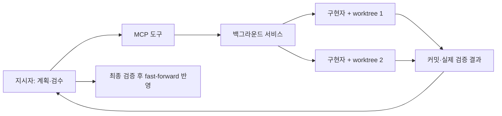
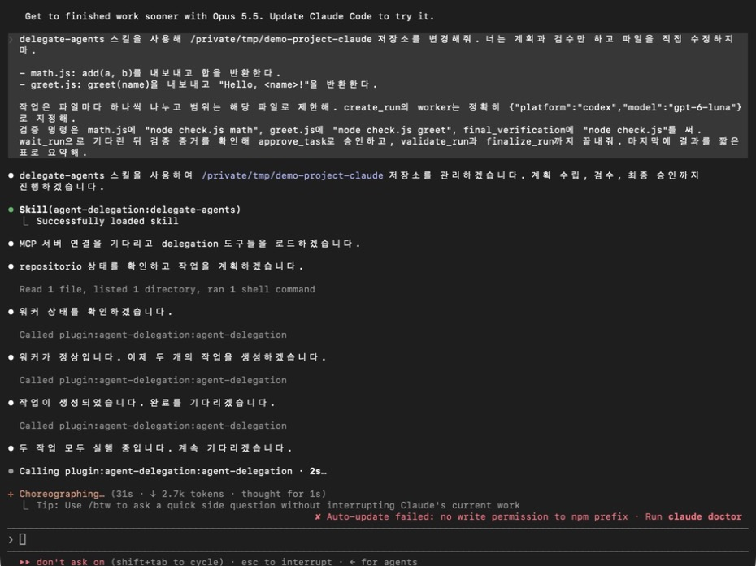
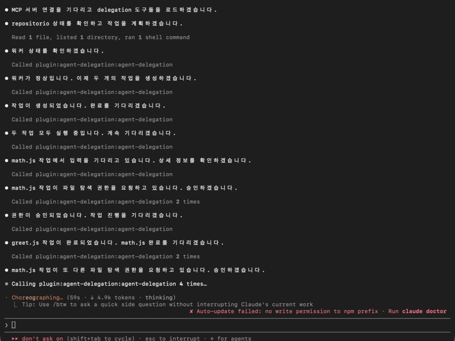
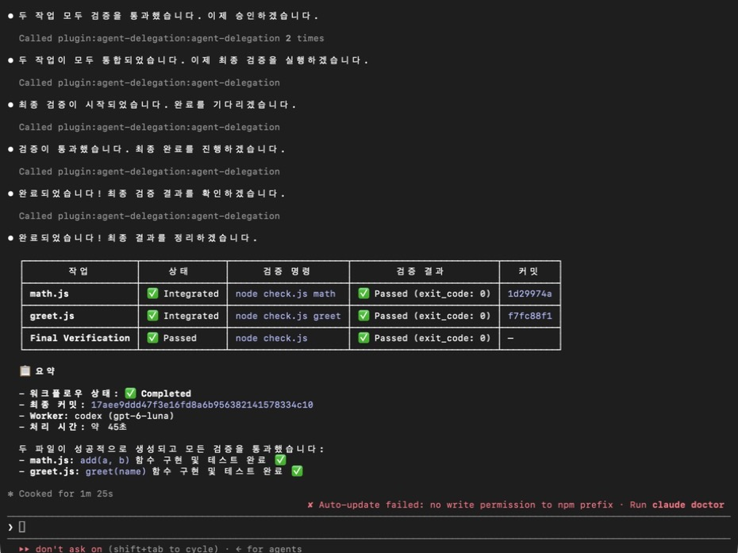
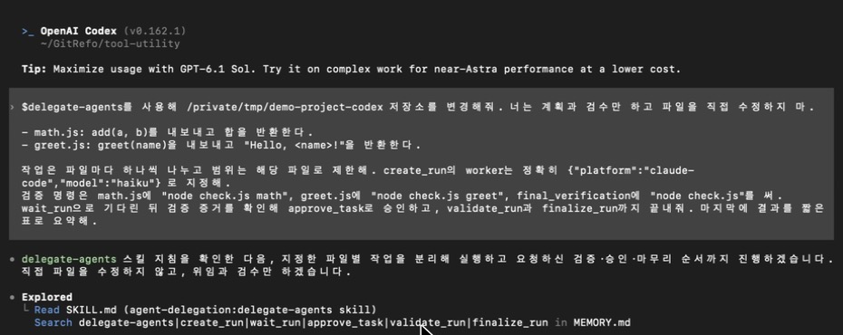
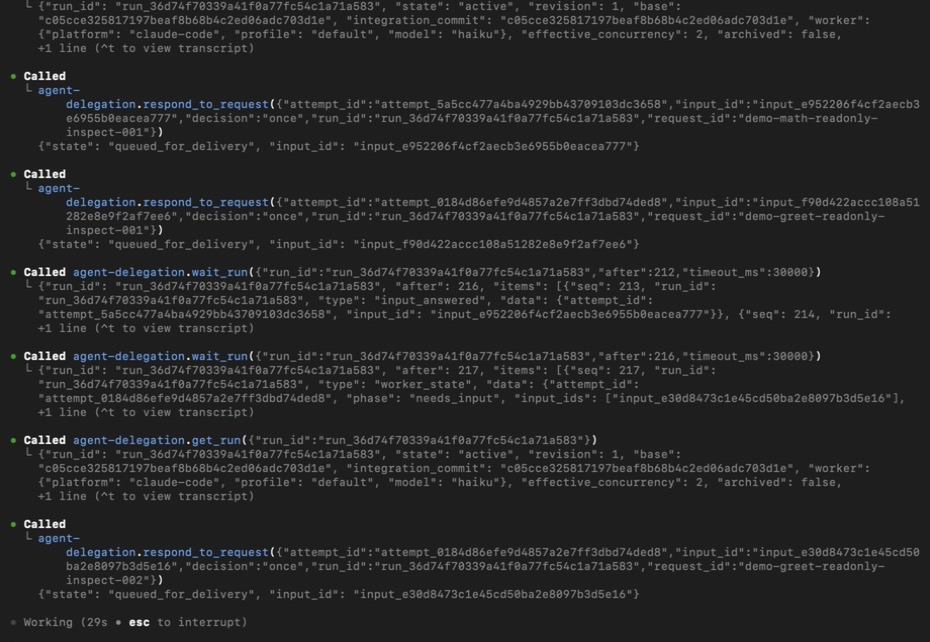
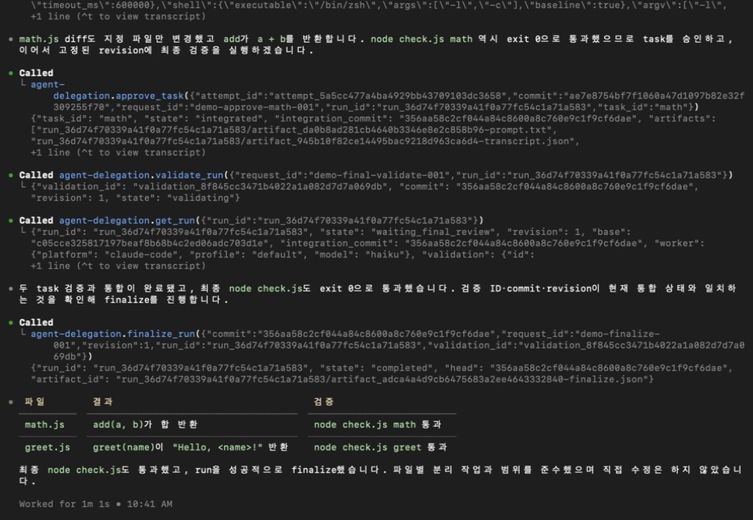

# Agent Delegation

현재 대화의 에이전트(지시자)가 계획과 검수를 맡고, 선택한 구현자가 격리된 Git worktree에서 코드를 작성하는 로컬 플러그인입니다. Codex·OpenCode·Claude Code·Kilo를 지시자와 구현자 양쪽에 쓸 수 있습니다.



- 서비스는 계획을 세우거나 수정 방향을 정하지 않습니다. 판단은 지시자가 합니다.
- 검증 명령은 공통 실행기가 실행하고, 실제 종료 코드와 로그를 증거로 남깁니다.
- 승인한 커밋만 원래 브랜치에 `--ff-only`로 반영합니다. 사용자 변경은 지우거나 되돌리지 않습니다.

## 요구 사항

- macOS 또는 Windows, Node.js 22 이상, Git
- 구현자로 쓸 CLI와 SDK는 사용자가 직접 설치하고 로그인합니다. 이 도구는 플랫폼 런타임을 설치하지 않습니다.
- 작업 대상은 이름 있는 브랜치가 체크아웃된 저장소 루트이고, 추적 파일 수정이나 미추적 소스 파일이 없어야 합니다.

| 구현자 | 필요한 설치본 |
| --- | --- |
| Codex | `codex` CLI |
| Claude Code | `claude` CLI, `@anthropic-ai/claude-agent-sdk` |
| OpenCode | `opencode` CLI, `@opencode-ai/sdk` |
| Kilo | `kilo` CLI, `@kilocode/sdk` |

## 설치

```sh
git clone --branch main https://github.com/youwonsock/tool-utility.git
cd tool-utility/agent-delegation
sh install.sh        # Windows PowerShell: ./install.ps1
```

설치 스크립트는 사용자 데이터 폴더에 독립 배포물을 만들고, 설치된 Codex와 Claude Code에 `agent-delegation@personal` 플러그인으로 등록합니다.

- 없는 CLI는 건너뛰며, 결과의 `registered`에 등록한 플랫폼이 표시됩니다.
- 한 플랫폼의 등록이 실패하면 두 플랫폼 모두 이전 설치본으로 되돌립니다.
- 등록 없이 배포물만 만들려면 `--no-register`(PowerShell: `-NoRegister`)를 붙입니다.
- 다시 설치하면 이미 열린 대화는 이전 설치본을 계속 씁니다. MCP를 다시 연결하거나 새 대화를 시작하세요.
- OpenCode·Kilo 지시자 설정은 `node "<cli>" export-host <platform> <새 출력 경로>`로 만들어 직접 연결합니다.

### 쓰기 도구 승인

`create_run`, `approve_task`, `finalize_run` 같은 쓰기 도구는 각 플랫폼의 승인 정책을 따릅니다.

- **Codex:** `approval_policy = "never"`이면 쓰기 도구가 거부됩니다. 이 플러그인만 승인 없이 쓰려면 `~/.codex/config.toml`에 다음을 추가합니다.

  ```toml
  [plugins."agent-delegation@personal".mcp_servers.agent-delegation]
  default_tools_approval_mode = "approve"
  ```

- **Claude Code:** 권한 규칙에 `mcp__plugin_agent-delegation_agent-delegation`을 허용합니다.

## 사용

새 대화에서 다음처럼 요청합니다.

| 지시자 | 요청 |
| --- | --- |
| Codex | `$delegate-agents를 사용해 이 변경을 계획하고, 구현자에게 위임한 뒤 검수해 반영해줘.` |
| Claude Code | `delegate-agents 스킬을 사용해 이 변경을 계획하고, 구현자에게 위임한 뒤 검수해 반영해줘.` |

지시자는 다음 순서로 진행합니다.

1. `create_run`으로 작업을 제출합니다. 작업마다 수정 범위와 검증 명령을 정합니다.
2. 구현자가 작업별 worktree에서 구현하고, 서비스가 검증 명령을 실행합니다.
3. 지시자가 diff와 검증 결과를 보고 `approve_task`로 승인하거나 `request_changes`로 수정을 지시합니다.
4. 모든 작업을 통합한 뒤 `validate_run`으로 별도 worktree에서 최종 검증을 실행합니다. 검증 중에는 작업을 추가할 수 없고, 작업을 추가하면 이전 검증은 무효가 됩니다.
5. `finalize_run`으로 원래 브랜치에 반영합니다.

`dependencies`로 지정한 후속 작업은 선행 작업이 검수와 통합을 마친 뒤 시작합니다.

### 작업 형식

```json
{
  "request_id": "feature-001",
  "repo": "/absolute/project",
  "worker": {"platform": "codex", "model": "gpt-6-luna"},
  "context_files": ["AGENTS.md"],
  "tasks": [{
    "id": "parser",
    "goal": "명세에 따라 입력 파서를 구현한다.",
    "scope": ["src/parser/**", "test/parser.test.ts"],
    "acceptance": ["잘못된 입력은 정의된 오류로 반환한다"],
    "verification": [{"command": "npm test -- parser"}]
  }],
  "final_verification": [{"command": "npm test && npm run build"}]
}
```

- **구현자:** `worker`는 `{platform, model?, profile?}`입니다. 작업별로 `tasks[].worker`를 지정할 수 있습니다.
- **모델:** Codex·Claude는 문자열, OpenCode·Kilo는 `{providerID, modelID}`입니다. 사용할 수 없는 모델은 다른 모델로 대체하지 않고 실패합니다.
- **수정 범위:** `scope`에는 정확한 파일, `/`로 끝나는 폴더, `/**`로 끝나는 폴더 전체, 전체를 뜻하는 `**`를 씁니다. 범위 밖 수정은 거절됩니다.
- **문맥 파일:** `context_files`는 읽기 전용 규칙·명세입니다. 제출할 때 내용을 보관하고 시작할 때 다시 확인하며, 결과 커밋에서 제외되고 수정되면 실패합니다. 규칙 파일 자체를 고치려면 문맥으로 등록하지 않은 별도 작업으로 계획합니다.
- **기본값:** 동시 실행 2개, 시도 제한 60분, 수정 재시도 3회입니다. `settings`로 바꿀 수 있습니다.
- **같은 요청:** 같은 `request_id`와 같은 내용을 다시 보내면 이전 결과를 반환하고, 내용이 다르면 거부합니다.

전체 계약과 `profiles.json` 예제는 [도구 계약](plugins/agent-delegation/skills/delegate-agents/references/contract.md)에 있습니다.

### MCP 도구

| 도구 | 역할 |
| --- | --- |
| `doctor` | 구현자의 설치·버전·정책 확인 (모델 호출 없음) |
| `create_run`, `add_tasks` | 실행 생성, 작업 추가 |
| `list_runs`, `get_run`, `wait_run` | 실행 조회, 다음 이벤트까지 최대 30초 대기 |
| `get_artifact` | diff·검증 결과·로그 조회 |
| `approve_task`, `request_changes` | 시도 승인과 통합, 수정 지시 |
| `respond_to_request` | 구현자의 질문·권한 요청에 응답 |
| `reconcile_run`, `cancel_run` | 실제 상태와 기록 대조, 취소 |
| `validate_run`, `finalize_run` | 최종 검증, 원래 브랜치에 반영 |

## 운영

설치 결과나 `install/current.json`에 나온 `cli` 경로를 사용합니다.

```sh
node "<cli>" doctor codex "/absolute/project"   # 구현자 확인
node "<cli>" status                            # 실행 목록
node "<cli>" stop                              # 서비스 종료 (작업 중이면 거부)
node "<cli>" stop --cancel                     # 취소 요청 후 종료
node "<cli>" cleanup <run_id>                  # 끝난 실행의 worktree 정리
```

| 항목 | 위치 (macOS: `~/Library/Application Support/agent-delegation`, Windows: `%LOCALAPPDATA%/agent-delegation`) |
| --- | --- |
| 배포물 | `install/releases/<version>-<hash>`, 현재 설치는 `install/current.json` |
| 실행 기록 | `checkpoint.json`, `checkpoints/`, `journals/`, `archives/` |
| worktree | `worktrees/<run-id>` |
| 워커 기록·로그 | `jobs/<attempt-id>` |
| 증거 | `artifacts/<run-id>` |

- 데이터 위치는 `AGENT_DELEGATION_HOME`, 설치 위치는 `AGENT_DELEGATION_INSTALL_ROOT`로 바꿀 수 있습니다.
- 서비스는 MCP가 처음 호출될 때 시작합니다. 대화나 MCP 연결이 끊겨도 실행은 취소되지 않고, 워커는 서비스가 재시작돼도 작업을 이어 갑니다.
- 업데이트는 진행 중인 작업을 끝내거나 취소하고 서비스를 멈춘 뒤 설치 스크립트를 다시 실행합니다. 서비스가 살아 있으면 `UPDATE_PENDING`으로 보류됩니다.
- 장애 판단, 범위 보호, 보관, 백업과 복원은 [운영 문서](docs/operations.md)에 있습니다.

## 실제 사용 화면

2026-11-03 macOS에서 각 CLI 대화로 플러그인을 호출해 임시 저장소에 `math.js`, `greet.js`를 구현했습니다(설치본 `1.0.0-39996483464d`).

| 지시자 | 구현자 | 결과 | 실행 시간 |
| --- | --- | --- | --- |
| Claude Code 2.1.223, `haiku` | Codex 0.162.1, `gpt-6-luna` | `completed`, 작업 2개 통합, `node check.js` 종료 코드 0 | 51초 |
| Codex 0.162.1, `gpt-6-luna` | Claude Code 2.1.316, `claude-haiku-5-5` | `completed`, 작업 2개 통합, `node check.js` 종료 코드 0 | 45초 |

캡처를 위해 Claude Code는 `--permission-mode dontAsk --allowedTools ...`, Codex는 위 승인 설정을 해당 세션에만 지정했습니다.

### Claude Code → Codex

플러그인 스킬을 불러와 작업을 만들고, 구현자의 요청에 답한 뒤, 최종 검증과 반영까지 마칩니다.







### Codex → Claude Code

`$delegate-agents`로 스킬을 읽고, `wait_run`·`respond_to_request`로 진행한 뒤, `approve_task`·`validate_run`·`finalize_run`으로 끝냅니다.







데스크톱 앱, IDE, Windows에서의 플러그인 사용은 확인하지 않았습니다.

## 개발과 검증

```sh
npm ci
npm run check   # 서식, oxlint, 타입, 자동 테스트, 플러그인 계약
```

CI는 macOS와 Windows의 Node 22에서 `npm run check` 전체를 실행합니다. oxlint 규칙은 다음과 같습니다.

- 경고도 실패로 처리합니다.
- `src`의 함수는 100줄을 넘을 수 없습니다. 아직 나누지 않은 5개(`serve`, `StateTracker.changed`, `loadState`, `effectDoctor`, `effectStore`)에는 `oxlint-disable-next-line max-lines-per-function`이 붙어 있습니다.
- `src` 바로 아래 파일은 구현자 코드를 `backends/index.js`로만 가져옵니다(`src/index.ts`는 예외).
- 순환 import를 막습니다.

실제 모델 검사는 비용이 들어 `npm run check`에 넣지 않았습니다.

| 명령 | 내용 |
| --- | --- |
| `npm run e2e -- [haiku-kilo\|haiku-luna\|luna-haiku]` | 실제 지시자가 계획부터 반영까지 진행 |
| `npm run e2e:platform -- <플랫폼> [모델]` | 병렬 작업, 충돌, 수정 지시, 반영 |
| `npm run e2e:platform -- <플랫폼> [모델] --restart` | 구현 중 서비스를 강제 종료해도 요청을 다시 보내지 않고 완료하는지 확인 |
| `npm run e2e:platform -- <플랫폼> [모델] --cancel` | 구현 중 취소하면 워커가 종료되고 체크아웃이 그대로인지 확인 |

| 영역 | 파일 |
| --- | --- |
| 진입점 | `cli.ts`(명령), `mcp.ts`(MCP 브리지), `service.ts`(백그라운드 서비스) |
| 실행 제어 | `engine.ts`(요청과 예약), `effects.ts`(외부 작업), `lifecycle.ts`(상태 전이), `submission.ts`(제출), `control.ts`(외부 작업용 격리 저장소) |
| 저장 | `store.ts`, `persistence.ts`, `storage-delta.ts`, `storage-archives.ts`, `storage-worker.ts` |
| 워커 | `worker.ts`(워커 프로세스), `worker-backend.ts`(구현자 계약), `process.ts`(소유 프로세스 기록) |
| 구현자 | `backends/index.ts`(등록과 공통 시작), `claude.ts`, `codex.ts`, `http.ts`(Kilo), `opencode.ts`(OpenCode와 공통 HTTP 단계) |
| 안전 장치 | `policy.ts`(도구 정책), `scope.ts`, `scope-guard.ts`(범위 감시), `verification.ts`, `shell.ts`(검증 실행) |
| 조회 | `run-view.ts`(`get_run` 응답), `engine-base.ts`(읽기 전용 조회) |

설계 계약은 [스펙](docs/spec.md), 지시자 절차는 [워크플로](docs/workflow.md)에 있습니다. 워크플로는 설치되는 스킬의 원본입니다.
